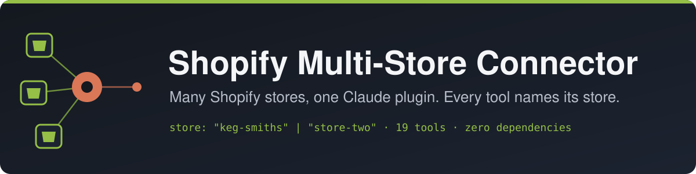
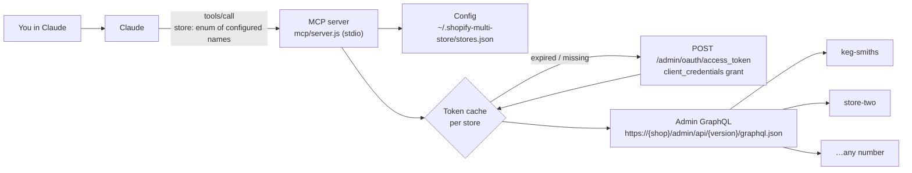

<div align="center">



[](https://github.com/JuicedSystems/claude-shopify-multi-store/actions/workflows/ci.yml)
[](LICENSE)
[](https://nodejs.org/)
[](#quickstart)
[](https://modelcontextprotocol.io/)
[](https://shopify.dev/docs/api/admin-graphql)
[](mcp/package.json)

</div>

Connect **any number of Shopify stores** to Claude at once. Every tool has to be told which
store to act on, and it can only pick from the stores you've configured. So when you switch
between projects, Claude can't quietly work on the wrong shop.

```text
You:     Show unfulfilled orders in keg-smiths from the last week.
Claude:  → list_orders { "store": "keg-smiths", "query": "fulfillment_status:unfulfilled created_at:>=2026-10-03" }
         keg-smiths has 3 unfulfilled orders from the last 7 days: …

You:     Now archive everything tagged discontinued, in store-two.
Claude:  → list_products   { "store": "store-two", "query": "tag:discontinued" }
         → update_product  { "store": "store-two", "id": "…", "status": "ARCHIVED" }  ×4

You:     Do the same in my-other-shop.
Claude:  my-other-shop isn't a configured store (configured: keg-smiths, store-two).
         Want to connect it with add_store?
```
<sub>The transcript above is illustrative. The tool names and the required `store` argument match the server's real tool schema.</sub>

## Features

- **The store guardrail.** On every store tool, `store` is a required argument whose JSON-schema `enum` is your configured store names. Claude can't skip naming a store, and it can't make one up.
- **Credentials handled for you.** You give it a Dev Dashboard client ID and secret (`shpss_…`) once. The connector mints 24-hour access tokens with the OAuth client-credentials grant and renews them on its own. Legacy `shpat_` tokens work too.
- **Add stores from chat.** `add_store` checks the credentials against Shopify, then saves them. The new store works right away, with no restart.
- **No dependencies.** It's a plain Node 18+ MCP server that speaks stdio JSON-RPC directly. There's no `npm install` and no `node_modules`.
- **19 tools.** Shop, products, orders, customers, collections and inventory, plus raw `graphql_query` / `graphql_mutation` for everything else (still scoped to a store).
- **Never shows a token.** Tools don't echo credentials back, and `list_stores` returns names and domains only.

## Quickstart

### 1. Install the plugin

In Claude, add this repo as a marketplace, then install the plugin from it:

```bash
/plugin marketplace add JuicedSystems/claude-shopify-multi-store
/plugin install shopify-multi-store@juiced-systems
/reload-plugins
```

> Requires Node.js 18+ on your PATH (`node --version`).
> Developing locally? Point the marketplace at your checkout instead:
> `/plugin marketplace add ./claude-shopify-multi-store`

### 2. Get credentials for each store (2026 flow)

As of **Jan 1, 2026** Shopify deprecated the old "Develop apps → reveal `shpat_` token" flow.
Apps are now built in the **Dev Dashboard**, which gives you a **Client ID** and **Client
Secret** (`shpss_…`). This connector uses those to mint 24-hour access tokens automatically
(the OAuth *client credentials* grant) and refreshes them for you — you never manage a token
by hand.

For **each** store:

1. Go to the **Shopify Dev Dashboard** ([dev.shopify.com](https://dev.shopify.com)) → create an
   app (or reuse one) for your organization.
2. Configure the **Admin API access scopes** the app needs, e.g.:
   - `read_products`, `write_products`
   - `read_orders`
   - `read_customers`
   - `read_inventory`, `write_inventory`
   - `read_publications`, `write_publications` (if you manage collections)
3. **Install the app on the store** you want to connect (client credentials only works for apps
   installed in stores your organization owns).
4. Copy the app's **Client ID** and **Client secret** (`shpss_…`) from the app's credentials/API
   access page.

> **Client ID vs Client Secret:** you need *both*. The `shpss_…` value is the secret; the Client
> ID is the other value on the same page. A `shpss_…` value on its own cannot call the API.
>
> **Already have a legacy `shpat_` token?** That still works — put it in `adminAccessToken`
> instead of the client ID/secret.

### 3. Add your stores

**The easy way — just tell Claude (no files to touch):**

> "Add my Shopify store **keg-smiths**, domain `keg-smiths.myshopify.com`, client id `…`,
> client secret `shpss_…`"

That calls the `add_store` tool, which **validates the credentials against Shopify** (mints a
token and does a quick shop lookup), saves them, and makes the store usable **immediately — no
restart**. If anything's wrong it tells you and saves nothing. Or run `/shopify-setup` to be
walked through it. Remove a store the same way: *"remove the store-two connection."*

> Prefer secrets never appear in chat? Use the file method below — Claude reads the file but you
> type the secret yourself.

**The file way (optional).** The connector stores everything in one JSON file:

| OS | Path |
|----|------|
| Windows | `C:\Users\<you>\.shopify-multi-store\stores.json` |
| macOS / Linux | `~/.shopify-multi-store/stores.json` |

> Not sure of the exact path? Ask Claude to **list your Shopify stores** (`/shopify-stores`).
> If the file is missing, the tool reports the precise path. Override the location with the
> `SHOPIFY_STORES_CONFIG` environment variable.

Copy [`stores.example.json`](stores.example.json) to that path and fill it in:

```json
{
  "defaultApiVersion": "2025-10",
  "stores": [
    {
      "name": "keg-smiths",
      "label": "Keg Smiths (production)",
      "shopDomain": "keg-smiths.myshopify.com",
      "clientId": "your-dev-dashboard-app-client-id",
      "clientSecret": "shpss_xxxxxxxxxxxxxxxxxxxxxxxxxxxxxxxx"
    },
    {
      "name": "store-two",
      "label": "Second Store",
      "shopDomain": "my-second-store.myshopify.com",
      "clientId": "another-client-id",
      "clientSecret": "shpss_yyyyyyyyyyyyyyyyyyyyyyyyyyyyyyyy"
    }
  ]
}
```

Field notes:
- `name` — short, unique, kebab-case. **Tip:** name each store to match its project, so
  "which store" is obvious to both you and Claude.
- `shopDomain` — the `*.myshopify.com` domain (protocol/paths are stripped automatically).
- `clientId` + `clientSecret` — from the store's Dev Dashboard app (preferred). The connector
  mints/refreshes tokens itself. *(Or use `adminAccessToken` with a legacy `shpat_` token.)*
- `apiVersion` — optional per-store override of `defaultApiVersion`.

Restart Claude (or `/reload-plugins`) after editing the file — it's read at startup.

## Usage

Just tell Claude which store to work with:

- *"List active products in **keg-smiths**."*
- *"Show unfulfilled orders in **store-two** from the last week."*
- *"Set inventory for SKU ABC-123 in **keg-smiths** to 40 at the main location."*
- *"In **store-two**, archive every product tagged `discontinued`."*

Slash commands: `/shopify-stores` (list what's configured), `/shopify-setup` (guided connect).

## Tools

| Tool | Kind | What it does |
|------|------|--------------|
| `list_stores` | read | List configured stores (never shows tokens) + config path/errors |
| `add_store` | setup | Connect a store by name/domain/token; validates then saves; usable at once |
| `remove_store` | setup | Disconnect a store and delete its saved token |
| `get_shop_info` | read | Confirm shop name, plan, currency, timezone |
| `list_products` | read | List/search products (`query` supports Shopify search syntax) |
| `get_product` | read | Fetch one product by id or handle |
| `create_product` | **write** | Create a product |
| `update_product` | **write** | Update fields / change status (ACTIVE, ARCHIVED, DRAFT) |
| `list_orders` | read | List/search orders, newest first |
| `get_order` | read | Full order detail incl. line items |
| `list_customers` | read | List/search customers |
| `get_customer` | read | One customer's detail |
| `list_collections` | read | List/search collections |
| `create_collection` | **write** | Create a manual collection |
| `add_products_to_collection` | **write** | Add products to a manual collection |
| `get_inventory_levels` | read | Per-variant inventory across locations |
| `set_inventory_quantity` | **write** | Set available/on-hand at a location |
| `graphql_query` | read | Any Admin GraphQL **query** (metafields, discounts, markets, …) |
| `graphql_mutation` | **write** | Any Admin GraphQL **mutation** |

Anything the helpers don't cover is reachable through `graphql_query` / `graphql_mutation`,
still scoped to a required `store`.

## How it works



1. At startup, and after every `add_store` / `remove_store`, the server loads `stores.json`
   and rewrites the `store` enum on every tool schema.
2. On a tool call it looks up the named store. If the store isn't configured, the call
   fails with the list of valid names.
3. It gets a token: either a cached client-credentials token (renewed about 2 minutes
   before it expires) or the legacy `shpat_` token. Then it calls that store's Admin
   GraphQL endpoint.

### Auth: why there's no OAuth redirect

This uses Shopify's **client credentials grant** — a server-to-server OAuth flow meant
specifically for *apps your organization owns, installed in stores you own*. There's no login
redirect, no callback server, no user-facing consent screen: the connector POSTs your client
ID + secret to `https://{shop}/admin/oauth/access_token` and gets back a 24-hour access token,
which it caches and silently re-mints when it expires. You paste two values once; the connector
handles tokens forever after.

The full authorization-code OAuth flow is only needed if you distribute a public app that
*other people* install on *their* stores — not the case here.

## Configuration

| Field / setting | Where | Notes |
|---|---|---|
| `stores[].name` | `stores.json` | Short, unique, kebab-case. Becomes a value in the `store` enum |
| `stores[].label` | `stores.json` | Optional human-readable name |
| `stores[].shopDomain` | `stores.json` | `*.myshopify.com`; protocol and paths are stripped |
| `stores[].clientId` + `clientSecret` | `stores.json` | Preferred (2026+): Dev Dashboard app credentials |
| `stores[].adminAccessToken` | `stores.json` | Legacy `shpat_` token, instead of client ID/secret |
| `stores[].apiVersion` | `stores.json` | Per-store override of `defaultApiVersion` |
| `defaultApiVersion` | `stores.json` | e.g. `2025-10` |
| `SHOPIFY_STORES_CONFIG` | env var | Override the config file location |

Default config path: `~/.shopify-multi-store/stores.json` (Windows:
`C:\Users\<you>\.shopify-multi-store\stores.json`). See [`stores.example.json`](stores.example.json).

## Security

- `stores.json` holds live Admin API tokens. Keep it out of version control
  (this repo's `.gitignore` already excludes it) and off shared machines.
- Tools never echo tokens back; `list_stores` returns domains and names only.
- Scope each store's custom app to the minimum it needs. If a store should be read-only,
  don't grant `write_*` scopes — the write tools will simply fail for that store.

## Troubleshooting

- **"No stores.json found …"** — create the file at the reported path, then reload.
- **"Authentication failed (HTTP 401/403)"** — bad/rotated token, or the custom app lacks a
  required scope for that operation.
- **A field/mutation errors about the API version** — set a newer `apiVersion` for that store
  (Shopify ships quarterly versions like `2025-10`, `2026-01`).
- **New store not showing up** — the config is read at startup; `/reload-plugins` or restart.

## Development

```bash
cd mcp
npm test     # syntax-checks the server and runs an offline stdio smoke test
```

The smoke test ([`mcp/test/smoke.mjs`](mcp/test/smoke.mjs)) starts the server with a
throwaway two-store config. It checks the MCP handshake and the tool list, and confirms
that every store tool requires `store` with exactly the configured names. CI runs it on
Node 18, 20 and 22.

## Contributing

Issues and pull requests are welcome. Useful contributions include new helper tools
(keep them store-scoped), fixes for Shopify API version changes, and bug reports with
the exact error a tool returned. Please run `npm test` in `mcp/` before opening a PR.

## License

[MIT](LICENSE) © 2026 Juiced Systems

---

<div align="center">

Built by **Dylan Smith** / [Juiced Systems](https://github.com/JuicedSystems) · [dielawn.com](https://dielawn.com)

</div>
